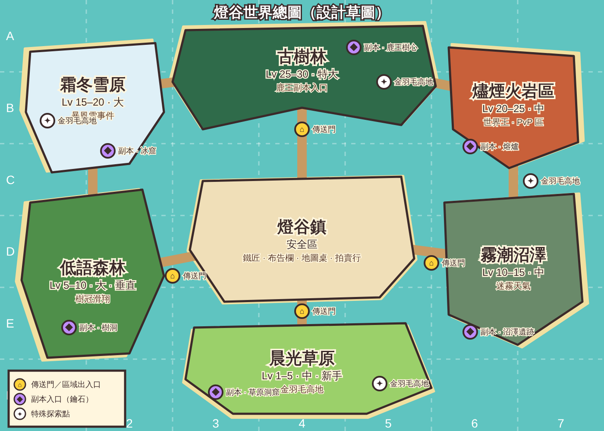

# 燈谷行 Lantern Vale — 計畫與待辦（2026-11-22）

設計細節見 Claude Doc「區域＋副本＋交易 設計文件」：https://claude.ai/artifact/HPY3ip7hotmK3MFMLBFWxo

## 已完成
- v1 基礎：Three.js 低解析度像素 3D、A Short Hike 風格、逐層 Roguelike ARPG
- v2：音效音樂、WASD 修正、寬通道、跳躍/攀爬/滑翔、城鎮、Node ws 多人（離線 NPC）
- GitHub 工作流（stacked 草稿 PR #1–#5），風格參考庫（reference/）
- A Short Hike 風 UI、豐富城鎮、風吹草動與水波、設定頁
- 跨局成長（PR #5）：星砂、金羽毛、貝殼、每日委託、傳家寶鐵匠、出發詞綴
- 輸入改版：空白鍵單擊翻滾、連按兩下跳起、按住第二下滑翔；Shift 空出

## 已決定（Alan）
- 方向：Roguelike → MMORPG 結構（常駐區域＋副本＋交易市場）
- 死亡：掉 25% 素材（墓碑可撿回），鎮上復活；裝備與星砂不掉
- PvP：允許，僅限標記區域與主動開啟
- 角色等級：加入，上限 30
- 線上版：先維持離線模擬，資料結構按可接伺服器設計
- 區域尺寸：獨立場景，大區 100×100、小區 60×60，先不分塊載入
- 要做：世界總圖、角色選擇頁

## 進度清單
### 階段 0：先行
- [x] 遊戲內 M 鍵世界地圖與區域介紹
- [x] 角色選擇頁：膚色/髮色/髮型/眉毛/臉＋隨機鍵；多角色存檔；職業選擇；模型支援替換頭髮與臉
### 階段 1：區域骨架
- [x] 常駐大區域（晨光草原，60×60）、怪物重生、普通/精英/傳奇怪、素材掉落、墓碑（掉 25% 素材可取回，不掉裝備與星砂）
- [x] 現有房間制接成「副本」入口與鑰石
- [x] 角色等級（上限 30）與經驗值、怪物等級、HUD 經驗條與大區域方位指引
- [ ] 量測手機/一般電腦真機幀數（已提供 `tests/performance.cjs`）
### 階段 2：經濟
- [x] 鐵匠用素材鍛造（素材工坊）；離線拍賣行（溪畔拍賣行：NPC 商人每 5 分鐘調價、獨立行情與低價/平盤/高價提示、10% 稅、寄售與裝備綁定）；金幣
### 階段 3：內容
- [x] 其餘 5 區域（低語森林 100×100、霧潮沼澤 60×60、霜冬雪原 100×100、燼煙火岩區 60×60、古樹林 100×100）、天氣（濃霧、暴風雪、火星、螢火）、世界事件/守護獸世界王、M 鍵傳送點、火岩演武場 PvP 模擬對手
### 階段 4：長線
- [x] 採集（砍香杉木/挖星紋礦/釣溪銀魚）、烹飪 buff（香煎溪魚每秒回血＋HUD 倒數）、武器流派（燈杖/短弓/雙刀/守衛盾＋餘燼技能寶石）、家園升級（旅人小屋 4 階段）、生物圖鑑
- [x] 線上版：伺服器權威公會組隊副本（共鳴樹庭，中央視野清空）、公會交易所（SQLite 持久化真人拍賣行與 10% 稅）
- [x] `Shift` 鍵綁定為疾步衝刺（消耗體力羽毛、移速 +35%）

## 一直掛著的待辦
- [ ] Godot MCP、Mixamo MCP：設定片段已給 Alan，需他自己貼進 Claude 設定（Mixamo token 由他輸入）
- [ ] 真機 FPS 未測（可於本機終端執行 `node tests/performance.cjs`）
- [ ] 多人伺服器需自架（Artifact 的 CSP 擋 WebSocket）
- [ ] YouTube 參考影片雲端抓不到，以截圖代替
- [ ] 本專案的 PR 皆為草稿；Release/tag 只在 Alan 說 "release" 時才做
